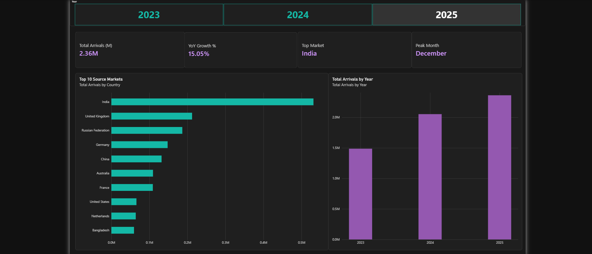
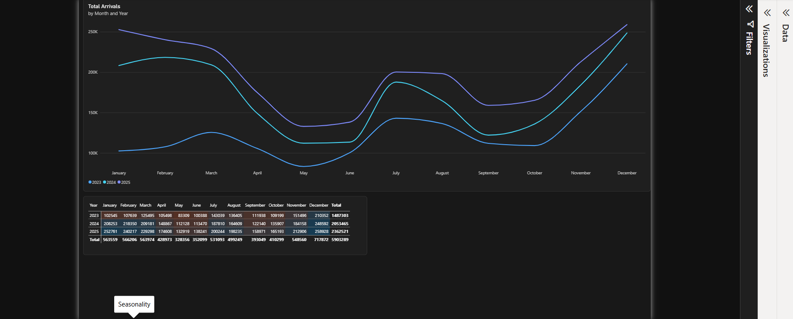
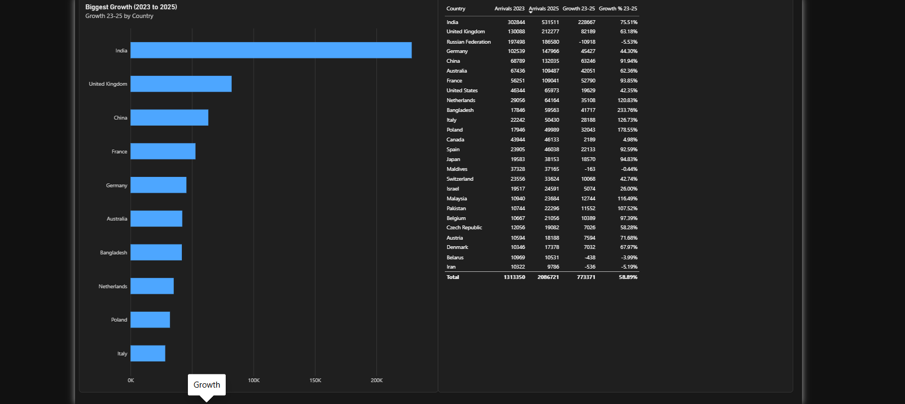

# 🇱🇰 Sri Lanka Tourism Data Analysis (2023 – 2025)

## 📌 Project Overview
The **Sri Lanka Tourism Data Analysis** project analyzes historical tourist arrival data from 2023 to 2025 to uncover trends, seasonal patterns, and key source markets contributing to Sri Lanka's tourism sector.

By combining Python, MySQL, and Power BI, this project explores changes in tourist arrivals over time, identifies peak and off-peak seasons, and evaluates top source countries. The resulting insights provide data-driven recommendations to help tourism stakeholders, businesses, and policymakers optimize marketing strategies and resource planning.

### 🌐 [View the Live Dashboard →](https://sl-tourism-dashboard.vercel.app/)
An interactive web version of this analysis, built with React, Tailwind CSS and Recharts ([source code](https://github.com/shihariAyodya/sl-tourism-dashboard)).



---

## 🛠️ Tech Stack & Tools
- **Data Cleaning & Analysis:** Python (`pandas`, `numpy`, `matplotlib`)
- **Database Management & Querying:** MySQL / MariaDB (XAMPP, phpMyAdmin)
- **Data Visualization & Dashboard:** Power BI (DAX)
- **Web Dashboard:** React, Tailwind CSS, Recharts, deployed on Vercel
- **Environment:** Jupyter Notebook (local)

---

## 🎯 Key Objectives
1. **Data Preparation & Cleaning:** Clean, standardize, and consolidate yearly tourist arrival data (2023–2025) using Python.
2. **Database Querying:** Store structured data in MySQL and write analytical queries to evaluate peak/off-peak months and top source markets.
3. **Interactive Visualization:** Build a dynamic Power BI dashboard illustrating seasonality, growth trends, and top source markets.
4. **Actionable Insights:** Generate data-driven recommendations to support business and strategic planning.

---

## 🔄 Project Roadmap & Status
- [x] **Project Setup & Data Collection** (2023, 2024, and 2025 datasets acquired)
- [x] **Repository Initialized**
- [x] **Data Cleaning & Standardization** (Python / Pandas)
- [x] **Data Combining** (3 years joined into one long-format table)
- [x] **Exploratory Data Analysis (EDA)** (Python)
- [x] **MySQL Database Schema & Analytical Queries**
- [x] **Power BI Interactive Dashboard** (3 pages)
- [x] **Final Report & Recommendations**
- [x] **Live Web Dashboard** (React + Tailwind, [view it here](https://sl-tourism-dashboard.vercel.app/))
- [ ] **Advanced SQL Queries** (YoY growth, rankings, peak/off-peak classification)
- [ ] **Map Page in Power BI**

---

## 📊 Data
- **Source:** Sri Lanka Tourism Development Authority (SLTDA), [Monthly Tourist Arrivals Reports](https://sltda.gov.lk/monthly-tourist-arrivals-reports)
- **Format:** 3 Excel files with monthly tourist arrivals by country (2023, 2024, 2025)
- **Final dataset:** `tourism_long.csv`, with 6,936 rows and 5 columns (Country, Year, Month, Arrivals, Month_Num)

---

## 🧹 Data Cleaning Summary
- Each yearly file had a different layout (header row, empty columns, month names), so each was cleaned separately
- Removed title rows, empty columns, the "Total" row, and 5 repeated header rows inside the 2025 file
- Filled one missing value (Papua New Guinea, May 2023 = 0), checked with the yearly total
- Verified that the 12 months add up to the yearly total for every country
- Standardized country names that were spelled differently between years (for example Viet Nam / Vietnam)
- Reshaped the combined data to long format and checked that total arrivals matched the wide format (5,903,289)

---

## 🗄️ SQL Analysis (MySQL)
- Created the `sl_tourism` database with the table `tourism_arrivals` and imported `tourism_long.csv`
- Checked the import: **6,936 rows** and **5,903,289 total arrivals**, the same as Python ✅
- Wrote queries for:
  - Total arrivals per year
  - Total arrivals per month (seasonality)
  - Top 10 source countries
- Every SQL result was cross-checked against the Python results ✅

Queries are saved in [`sql/02_analysis_queries.sql`](sql/02_analysis_queries.sql).

---

## 📈 Power BI Dashboard
A 3-page interactive dashboard with a year slicer:

| Page | What it shows |
|---|---|
| **Overview** | KPI cards (Total Arrivals, YoY Growth %, Top Market, Peak Month), Top 10 source markets, total arrivals by year |
| **Seasonality** | Monthly arrivals line chart by year and a seasonality heatmap |
| **Growth** | Top 10 markets by growth (2023 → 2025) and a growth table for all major markets |

**DAX measures:** Total Arrivals, Arrivals Prev Year, YoY Growth %, Market Share %, Top Market, Peak Month, Growth 23-25, Growth % 23-25




---

## 🔍 Key Findings

**1. Strong growth, but slowing**
| Year | Arrivals | Growth |
|---|---|---|
| 2023 | 1,487,303 | – |
| 2024 | 2,053,465 | +38.1% |
| 2025 | 2,362,521 | +15.1% |

Arrivals grew **58.8% from 2023 to 2025**. Part of this is recovery from a low 2023 start (January 2023: 102,545 vs January 2024: 208,253).

**2. Clear seasonal pattern (same in all 3 years)**
- **December** is the peak month (717,872 arrivals across 3 years)
- **May** is the lowest month (328,356 arrivals across 3 years)
- A smaller second peak in **July–August**, and quieter periods in **April–June** and **September–October**

**3. A few markets dominate**
- **India** is the top market with **21.2%** of all arrivals
- The **top 5** markets make up **52.0%** and the **top 10** make up **68.3%**

**4. Fastest-growing and falling markets (2023 → 2025)**
- Biggest growth in numbers: **India (+228,667)**, United Kingdom (+82,189), China (+63,246)
- Fastest growth in % (markets with 10,000+ arrivals in 2023): **Bangladesh (+234%)**, Poland (+179%), Italy (+127%), Netherlands (+121%)
- **Russian Federation fell 5.5%** and dropped from #2 to #3 in 2025, behind the UK
- China grew strongly in 2024, then stayed flat in 2025

---

## 💡 Recommendations
1. **Plan for peak season early.** Increase staff, stock and marketing for **November–March**, with the most capacity in December.
2. **Use the off-peak months well.** Run promotions in **May** and **September–October**, and schedule maintenance and staff training then.
3. **Reduce dependence on one market.** India brings in about 1 in 5 tourists, so spreading marketing across more countries lowers the risk.
4. **Invest in fast-growing markets.** Bangladesh, Poland, Italy and the Netherlands are growing fast and are worth targeted campaigns.
5. **Investigate Russia and China before acting.** Russia is declining and China has stopped growing, but the data does not explain why.

---

## ⚠️ Data Notes & Limitations
- Taiwan has data for 2023 only, and a few other countries are missing in some years
- 2023 started low, so part of the growth is recovery from a low base
- The 2024 "Congo" row was treated as the Democratic Republic of the Congo (an assumption based on row position and numbers)
- The data shows *what* changed, not *why* (for example, the Russia decline)

---

## 📁 Repository Structure
```text
├── data/
│   ├── raw/                  # Original 2023, 2024, and 2025 Excel files
│   └── clean/                # Cleaned CSV files (including tourism_long.csv)
├── sql/
│   ├── 01_create_table.sql   # Database and table setup
│   └── 02_analysis_queries.sql
├── powerbi/
│   └── sl-tourism.pbix       # Power BI dashboard
├── images/                   # Dashboard screenshots
├── 01_clean_2023.ipynb       # Jupyter Notebooks for cleaning & EDA
├── 02_clean_2024.ipynb
├── 03_clean_2025.ipynb
├── 04_combine.ipynb
└── README.md                 # Project documentation
```

---

## 👤 Author
**Shihari Ayodya**, Information Systems Undergraduate, Sabaragamuwa University of Sri Lanka
[GitHub](https://github.com/shihariAyodya) · [LinkedIn](https://linkedin.com/in/shihari-ayodya-33406a34b) · [Portfolio](https://shihari.vercel.app/)
